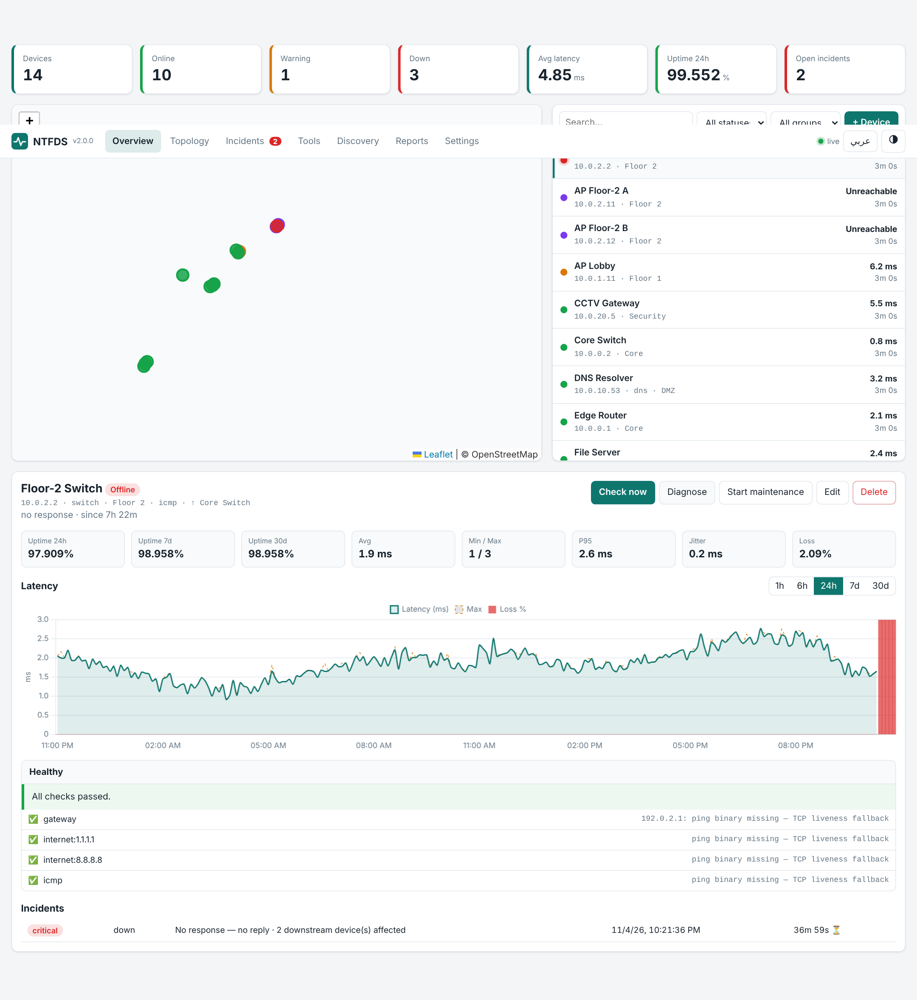
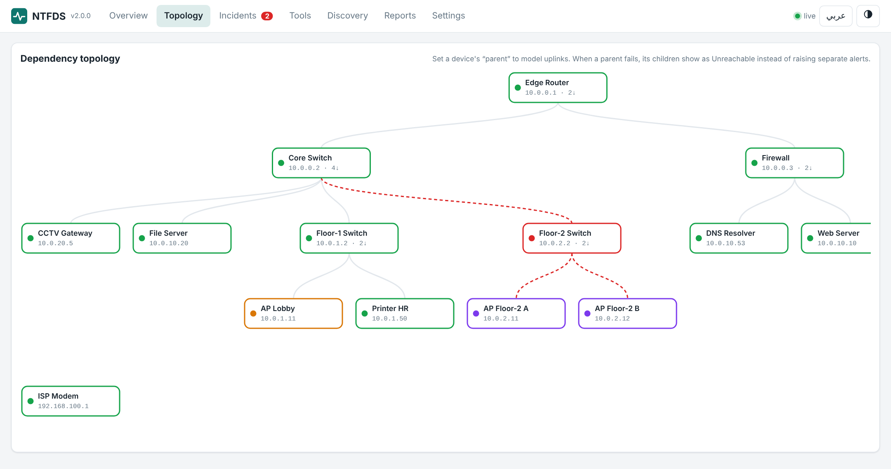
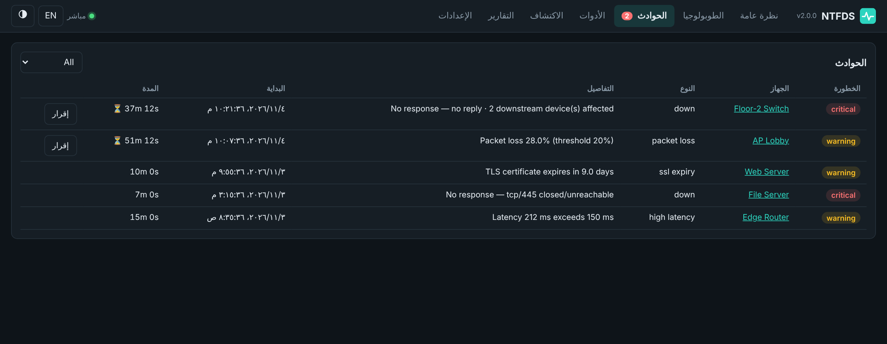

# Network Troubleshooting & Fault Detection System (NTFDS) v2

Self-hosted, **offline-first** network operations console: multi-protocol monitoring, root-cause-aware incidents,
automatic troubleshooting, discovery, SLA reporting and alerting — one `pip install`, no cloud, no CDN.

<p align="center"><br>
<br>
</p>

## Features

**Monitoring**
- Four probe types per device: **ICMP** (loss, latency, jitter over 4 pings), **TCP port**, **HTTP(S)** (status, latency, TLS expiry/untrusted cert), **DNS** (queries a specific resolver with a built-in UDP client).
- Concurrent probes in a worker pool, per-device interval and thresholds, enable/disable, **maintenance mode**.
- Works without a `ping` binary (TCP liveness fallback).

**Fault detection**
- Debounced failures (N consecutive misses before *Offline*), flapping detection that mutes alert storms.
- **Dependency-aware root cause:** set a device's parent; when the parent dies children become *Unreachable* and don't page anyone. The incident reports how many downstream devices are affected.
- Learned latency baseline flags sustained anomalies; also high latency, packet loss, jitter, HTTP errors, TLS expiry.
- Incident lifecycle (open → acknowledge → resolved) with duration, MTTR and downtime.

**Troubleshooting toolbox**
- **Auto-diagnose:** DNS → default gateway → Internet reference hosts → target ICMP → service → traceroute, then a verdict (*target down*, *local network*, *WAN/ISP outage*, *service down*, *degraded link*, *ICMP blocked*…) with suggested fixes.
- Ping, traceroute, DNS lookup, port scan (with banners), HTTP probe.
- **Network discovery:** sweep a CIDR (ICMP/TCP, reverse DNS, MAC from ARP) and add hosts in one click.

**Data & reporting**
- Live charts (1h–30d), uptime 24h/7d/30d, min/avg/P50/P95/P99. Raw checks kept 7 days, **hourly roll-ups ~400 days** (SQLite stays small).
- SLA report (uptime, incidents, MTTR, downtime) with CSV export; device CSV/JSON import/export.
- Prometheus endpoint `/metrics`, REST API under `/api`, Socket.IO live updates.

**Alerts:** webhook, Slack, Discord, Telegram, e-mail (SMTP); severity filter, resolve notices, Test button.

**UI:** map (Leaflet, works offline with a grid fallback), SVG topology, dark/light, **English / العربية with RTL**, toasts and desktop notifications. All JS/CSS vendored — no CDN.

**Security:** optional API token (UI, API, `/metrics`, websocket), strict host/URL/port validation (nothing reaches a shell), HTML-escaped UI, CSV formula-injection guard, port scan / discovery limited to private ranges unless `NTFDS_ALLOW_PUBLIC_SCAN=1`, concurrency cap on heavy tools, default bind `127.0.0.1`.

## Quick start

```bash
pip install -r requirements.txt
python app.py                 # http://127.0.0.1:5000
```
Existing v1 databases upgrade automatically (columns are added in place).

Docker: `docker compose up -d` (set `NTFDS_API_TOKEN` before exposing the port). To watch a real LAN from Docker on Linux use `network_mode: host`.

Try it with demo data: `python scripts/seed_demo.py demo.db && DATABASE_URL=sqlite:///$PWD/demo.db NTFDS_MONITOR=0 python app.py`

Optional system tools for richer diagnostics: `ping`, `traceroute`/`tracepath` (Windows: `tracert`).

## Configuration
See [`.env.example`](.env.example). Thresholds (latency, loss, jitter, failure count, TLS warning days, anomaly detection) are editable in **Settings**; each device can override latency/loss/interval.

## API (excerpt)
| | |
|-|-|
| `GET/POST /api/devices` · `PUT/DELETE /api/devices/<id>` | manage devices (`host` or legacy `ip`) |
| `POST /api/devices/<id>/check` · `/diagnose` | run now / auto-diagnose |
| `GET /api/devices/<id>/metrics?range=24h` | series + stats + uptime |
| `GET /api/incidents?status=open` · `POST /api/incidents/<id>/ack` | incidents |
| `POST /api/tools/{ping,traceroute,dns,ports,http,diagnose}` | toolbox |
| `POST /api/discovery` · `GET /api/discovery/<job>` | subnet discovery |
| `GET /api/reports/sla?days=30[&format=csv]` | SLA |
| `GET /metrics` | Prometheus |

Send the token as `Authorization: Bearer …` or `X-API-Key`.

## Layout
```
app.py            entry point          ntfds/engine.py       scheduler, state machine, incidents, roll-ups
ntfds/checks.py   ICMP/TCP/HTTP/DNS    ntfds/diagnostics.py  traceroute, scan, auto-diagnose, discovery
ntfds/api.py      REST + Prometheus    ntfds/alerts.py       notification channels
ntfds/analytics.py uptime/series/SLA   tests/                pytest suite (28 tests)
```
Run tests: `pip install -r requirements-dev.txt && pytest`

## Responsible use
Active tools (port scan, discovery) are for networks you own or are authorised to test.

## License
GPL-3.0 — see [LICENSE](LICENSE).
